
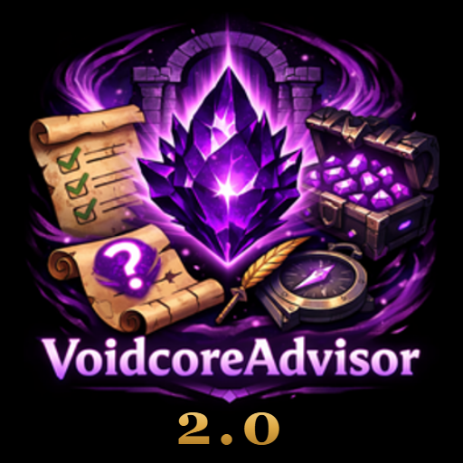

<h1 align="center"> VoidcoreAdvisor Reborn</h1>

<b>Know which loot spec gives you the best odds before you spend a Nebulous Voidcore.</b>

> **Fork of [VoidcoreAdvisor](https://github.com/rolferik12/VoidcoreAdvisor) by rolferik12**, continued with the author's explicit permission (MIT license). All original credit goes to rolferik12. Season data is generated with the author's [VoidcoreAdvisorGen](https://github.com/rolferik12/VoidcoreAdvisorGen).
>
> Changes in 2.0: patch 12.1.5 API fixes (`C_Item.GetItemInfo` / `C_Item.GetItemQualityColor`) and automatic loot-table reading for new raids (The Unbinding of Kith'ix) straight from the Encounter Journal.
>
> This is a separate addon (folder `VoidcoreAdvisorReborn`). Disable or remove the original VoidcoreAdvisor before using it, since both use the same saved variables.

VoidcoreAdvisor is a World of Warcraft addon for Retail (Patch 12.0.0+) that helps you make informed decisions when spending Nebulous Voidcores. It attaches a side panel to the Encounter Journal that displays the full loot pool for each raid boss or Mythic+ dungeon, broken down by specialization, alongside probability rankings that show which loot spec gives you the best odds of receiving the items you are after.

When you open the Encounter Journal and browse a boss or dungeon, VoidcoreAdvisor automatically shows every item available from that source. You can select specific items you are chasing, and the panel recalculates the probability for each of your specializations in real time, telling you the exact percentage chance that a Voidcore roll will land on one of your selected items for each spec. Specs with smaller remaining loot pools rank higher because each individual item has a greater share of the roll.

The addon tracks which items you have already obtained, either through manual checkboxes, through automatic detection after boss kills and Mythic+ completions, or by scanning your loot specializations against the Nebulous Voidcache to determine which items each spec can receive. Obtained items are excluded from the remaining pool calculations, so your probability numbers stay accurate as you gear up over the course of a season. Item selections and obtained status are saved per character.

When you zone into a current-season Mythic or Mythic+ dungeon, VoidcoreAdvisor checks whether your active loot specialization is the best match for the items you have selected from that dungeon. If a different spec would give you better odds and you have at least one Nebulous Voidcore to spend, a dialog popup appears showing your current spec, the recommended spec with its probability stats, and offers to switch your loot specialization with a single click. The reminder only triggers once per dungeon and can be disabled in the addon settings.

## 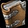 At a glance

| 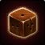 **Per-spec odds** | 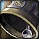 **Loot spec reminder** |  **Safe bonus roll** | 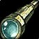 **Voidcache scan** |
| :---: | :---: | :---: | :---: |
| Probability of landing the items you chase, for every specialization. | A popup when you enter a dungeon on a worse spec for your selected items. | Two-click Roll button so you never spend a Voidcore by accident. | Reads each spec's Voidcache and marks what it can never receive. |

##  Key Features

-  Side panel anchored to the Encounter Journal with loot and spec ranking columns.
-  Per-spec probability calculation based on remaining loot pool size.
- 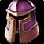 Item selection to compare which spec gives the best odds for specific pieces.
- 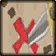 Automatic detection of items received via Nebulous Voidcores after encounters.
-  Loot spec reminder popup when entering a Mythic+ dungeon on a suboptimal spec for your selected items.
-  Bonus roll confirmation overlay that replaces the default Voidcore prompt with a two-click Roll button, preventing accidental spends.
-  Support for both raid bosses (Normal, Heroic, Mythic) and Mythic+ dungeons.
-  Adjustable key level selector for M+ that updates tooltip item levels to match the Voidcore reward track.
- 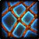 Spec and item filtering with cross-column highlighting.
-  Voidcache loot spec scanner that reads each specialization's Nebulous Voidcache tooltip and automatically marks items unavailable to each spec as obtained.
- 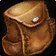 Persistent per-character tracking of obtained items and selections.
-  Localized in 11 languages: English, German, Spanish (EU/MX), French, Italian, Korean, Portuguese (BR), Russian, and Chinese (Simplified/Traditional).

###  Dungeon Overview

When the Encounter Journal is open on the instance list, a separate overview panel appears listing all current-season Mythic+ dungeons sorted by the highest single-item chance across your specializations. Each row shows the best-matching spec icon and name, the number of items remaining for that spec, and the percentage chance per Voidcore roll. A two-row grid of equipment slot buttons (head, neck, shoulders, back, chest, wrists, hands, waist, legs, feet, finger, trinket, weapon, off-hand) lets you narrow the ranking to only the slot types you are targeting.

###  Raid Overview

When the Encounter Journal is open on a raid's main page without a specific boss selected, a raid overview panel lists every boss in Encounter Journal order. Each row shows the best spec for that boss, items remaining, and the probability percentage — giving you a quick picture of which bosses are still worth rolling on and which spec to use for each.

###  Voidcache Loot Spec Scan

VoidcoreAdvisor can scan the Nebulous Voidcache tooltip for every one of your loot specializations to determine exactly which items each spec is eligible to receive. Items that a given spec cannot receive are automatically marked as obtained, which removes them from that spec's remaining pool and keeps probability numbers accurate without any manual work.

The scan iterates over every spec and dungeon (or raid boss) in a sequence designed to avoid the client returning stale cached data between consecutive reads. For each tooltip it waits until the line count reaches the required minimum, then keeps re-reading until two consecutive reads return the same number of lines, confirming the tooltip has fully loaded. The scan is automatically cancelled if you enter combat or if your loot spec is changed manually while it is running.

**Mythic+ dungeon scan** — click the **Scan Loot Specs** button in the top-right corner of the Dungeon Overview panel. The Dungeon Overview appears when the Encounter Journal is open on the instance list (not on a specific boss). The button is disabled while inside any instance or while a scan is already in progress.

**Raid scan** — click the **Scan Loot Specs** button in the top-right corner of the Raid Overview panel. The Raid Overview appears when the Encounter Journal is open on a raid's main page without a specific boss selected. The same restrictions apply: must be outside an instance and not already scanning.

Before the scan writes its results, a snapshot of all existing obtained data for that content type is saved to `SavedVariables`. If the results look wrong, run `/void restore` to roll back to the pre-scan state. M+ and raid backups are stored independently so running one scan never overwrites the other's backup.

###  Bonus Roll Confirmation

When a Nebulous Voidcore prompt appears, VoidcoreAdvisor replaces the default `BonusRollFrame` with a custom overlay window. The overlay sits at a higher frame level than the original so accidental mouse clicks on the underlying Roll and Pass buttons are blocked.

The window displays the item icon (hoverable for a full tooltip), the item name, your current Voidcore count and the cost of the roll, and a live timer bar that mirrors the countdown on the original frame. Your active loot specialization icon and name are shown inline. When the current dungeon or raid boss is recognized, the overlay also shows how many items from that source you still need and the per-specialization remaining counts, giving you the key information to decide whether to roll before committing.

**Roll** requires two clicks — a first click reveals a confirmation prompt, and a second click actually spends the Voidcore. This prevents accidental rolls. **Pass** fires immediately with a single click. Both buttons copy the appearance of the original Blizzard Roll and Pass buttons so the interface feels familiar.

The overlay can be enabled or disabled on the Options page. The per-spec item count list can also be toggled independently.

### 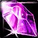 Loot Pool Accuracy

- Loot pool reads are now performed exclusively under a verified `WithEJState` filter. Results are only cached when the filter application succeeds, preventing inflated or unfiltered pools from being stored.
- The display item list in the panel is always intersected with the trusted per-spec pool. An empty trusted pool renders "no items" rather than falling back to raw Encounter Journal data.
- When the EJ returns an empty enriched item list but the trusted per-spec pool is non-empty (a transient read gap), display rows are synthesized directly from the trusted item IDs so the panel never shows a false "No items for this spec" state.
- Item spec metadata that is incomplete at read time is no longer cached or persisted, preventing empty or partial results from poisoning the pool for the entire session.
- Added a class-level eligibility fallback for items whose spec-set data has no overlap with the player's class specs, fixing "No items for this spec" on raid bosses for some classes.
- Persisted cache entries from prior sessions are version-gated and automatically discarded when the format changes, so stale or poisoned pools from earlier runs do not carry over.

### 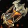 Cache Warm

- Cache warmup is now split into two phases: a fast item metadata primer (populates the client item cache so spec info is available promptly) followed by the class/spec filter cache build.
- The warm ticker no longer has a fixed iteration limit, so EJ availability pauses no longer exhaust the budget and cancel the process prematurely.
- Tick interval increased from 0 seconds to 0.25 seconds (capped at roughly 4 items per second), eliminating the multi-second FPS drops that occurred at login.
- Warmup is deferred until the player is outside an instance. If the season filter cannot be built at login (EJ data not yet ready), the process retries automatically.
- The loot pool cache is persisted to `SavedVariables` between sessions so subsequent logins complete warmup much faster.

###  Detection

- The Mythic+ key level is now captured at `CHALLENGE_MODE_START` and `CHALLENGE_MODE_COMPLETED` and persisted to `SavedVariables`, so the correct level is retained across `/reload` inside or immediately after a run.
- Dungeon identification now uses locale-independent instance IDs as the primary lookup, with a localized name lookup as fallback. This prevents misidentification for players using non-English clients.
- Detection and panel source state is cleared on zone transitions to prevent stale dungeon data from persisting after leaving an instance.

### 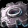 UI

- The chance column in both the Dungeon Overview and Raid Overview is wider (64 px) and word-wrap is disabled on all column headers and row labels, fixing a layout shift that caused the header to appear truncated and shifted downward on some characters.
- The Options page now includes a Preview button next to the reminder toggle so you can inspect the popup appearance without entering a dungeon.

##  Installation

1. Download this repository as a ZIP and extract it so the folder is named `VoidcoreAdvisorReborn`.
2. Move that folder to `World of Warcraft/_retail_/Interface/AddOns/`.
3. Disable or remove the original VoidcoreAdvisor, since both use the same saved variables.
4. Start the game (or type `/reload`) and open the Encounter Journal.

##  VoidcoreAdvisorGen (developer tool)

The season loot tables in `Core/SeasonData.lua` are generated in-game with [VoidcoreAdvisorGen](https://github.com/rolferik12/VoidcoreAdvisorGen) by rolferik12 (MIT). A copy adapted for 12.1.5 and for this fork lives in `tools/VoidcoreAdvisorGen`. It is not needed to play and is not part of the CurseForge download.

## 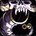 Credits

VoidcoreAdvisor was created by [rolferik12](https://github.com/rolferik12) (MIT). This fork is maintained by sr.kitkat with the original author's permission.

##  Commands

- `/void` shows the list of commands.
- `/void panel [name]` opens the Adventure Guide on a boss or dungeon with the panel showing.
- `/void missing [14|15|16]` lists every item you still need for your loot spec, best odds first.
- `/void export` and `/void import` copy your marked items between characters.
- `/void theme <name>` changes the window colors: green, purple, blue, light, fire, frost, red, `class`, `spec` (they follow your class or specialization) or a class like `mage`, `priest`, `deathknight`.
- `/void resetpanel` puts the panel back next to the Adventure Guide (drag the header to move it, drag the corner to resize it).
- `/void liveraid` forces reading a new raid from the Adventure Guide.
- `/void restore`, `/void replaylog`, `/void version`.

##  Translations

The addon is available in 11 languages. The newest texts were translated without a native review; if you find a wording that sounds wrong, please open an issue or a pull request with the corrected line from the matching file in `Locales/`.
